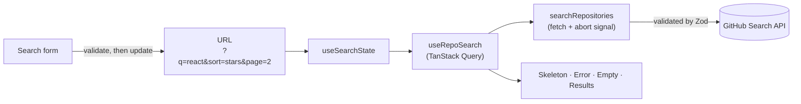

<div align="center">

# Repository Search · リポジトリ検索

**Search public GitHub repositories, with sorting, pagination, and an English / Japanese interface.**
**GitHubの公開リポジトリを検索できるアプリです。**

[**Live demo / デモ**](https://repo-search-chi.vercel.app/)

<sub>Click a language below to expand or collapse it. · 下の言語名をクリックすると開閉できます。</sub>

</div>

<details open>
<summary><b>🇬🇧 English</b></summary>

## Features

**Search**

- Search on submit with validation: empty input and over-long queries get a clear, translated message
- GitHub query qualifiers work as usual, for example `react language:typescript stars:>1000`
- Sort by best match, most stars, most forks, or recently updated

**Results and pagination**

- Cards show owner, name, description, language, stars, forks, and last update
- Compact counts (`238K`, or `23.8万` in Japanese), with the exact number for screen readers
- Real pagination with a page window, previous and next, and a compact “Page 3 of 34” view on phones
- GitHub only returns the first 1,000 results of any search, so the app caps the page count there and explains why

**Resilience**

- Distinct states for loading (skeletons), empty results, invalid query, network failure, unexpected data, and rate limit
- Rate-limit errors show a live countdown to the reset time, using GitHub’s own response headers
- Requests are cached, de-duplicated, and cancelled when superseded

**Shareable state**

- Query, sort, and page live in the URL, so a search can be bookmarked or sent to someone, and the back button works

**Interface**

- English and Japanese, defaulting to the browser’s language
- System, light, and dark themes, with no flash of the wrong theme on load
- Responsive from 320px phones to wide desktops

## Getting started

Requires Node.js. Developed and tested in CI on Node 26.

```bash
git clone https://github.com/abhishekkjp/repo-search.git
cd repo-search
npm install
npm run dev
```

| Command                | What it does                             |
| ---------------------- | ---------------------------------------- |
| `npm run dev`          | Start the development server             |
| `npm run build`        | Type-check and create a production build |
| `npm run preview`      | Serve the production build locally       |
| `npm test`             | Run all tests once                       |
| `npm run lint`         | Run ESLint (strict, type-aware rules)    |
| `npm run typecheck`    | Run the TypeScript compiler              |
| `npm run format`       | Format everything with Prettier          |
| `npm run format:check` | Check formatting without changing files  |

A pre-commit hook runs lint-staged and the type check, and CI runs formatting, lint, types, tests, and the build on every push.

## How it works



The URL is the single source of truth. Submitting the form or clicking a page updates the URL, the URL drives the query, and the query drives what is rendered. Nothing is copied into a second piece of state.

## Project structure

```
src/
├── components/
│   └── SegmentedControl/        Generic control, used by theme and language toggles
├── features/
│   └── search/
│       ├── api/                 Network client, Zod schema, typed errors
│       ├── components/          One folder per component: .tsx, .module.css, .test.tsx
│       │   ├── ErrorState/
│       │   ├── Pagination/
│       │   ├── RepoCard/
│       │   ├── ResultList/
│       │   ├── SearchForm/
│       │   └── …
│       ├── hooks/               URL state and the TanStack Query wrapper
│       └── utils/               Pure functions: pagination math, formatting, validation
├── i18n/                        Typed dictionaries, locale detection, provider
├── theme/                       Theme storage and toggle
├── styles/                      Design tokens and base typography
├── tests/                       Shared test setup, MSW server, fixtures
└── utils/                       Small generic helpers
```

Dependencies point one way: components use hooks, hooks use the API layer. Components never call `fetch`, and the `utils` folders contain no React and no network code, which keeps them easy to test.

## Key decisions

**TanStack Query for server state.**
Caching, request de-duplication, cancellation, retries, and loading states are all solved problems. Hand-writing them with `useEffect` is the usual source of race conditions. Previous results stay on screen while the next page loads, so paging doesn’t flash. Retries are disabled for rate-limit and invalid-query errors, since repeating those only wastes quota.

**Search on submit, not on every keystroke.**
Unauthenticated GitHub search allows roughly 10 requests per minute, so search-as-you-type would exhaust it even with debouncing. Submit-based search also avoids a Japanese input problem: pressing Enter to confirm an IME conversion must not trigger a search. A native `<form>` handles that correctly.

**Handling GitHub’s 1,000-result cap.**
`total_count` can say millions, but only the first 1,000 results are reachable. The app derives a “reachable” count from that limit and uses it for the page count, the result range, and a notice. The page request is clamped, and a bad `?page=` in the URL is corrected to the real last page without adding a history entry.

**Runtime validation with Zod.**
TypeScript types disappear at runtime, so the response is validated at the network boundary. Unexpected data becomes one typed error with a clear message instead of a crash somewhere in the UI.

**State in the URL.**
Searches are shareable and bookmarkable, and the back and forward buttons work. It uses the browser History API directly with `useSyncExternalStore`, so there’s no router dependency for three query parameters.

**Typed errors that carry no text.**
Errors have a `kind` and nothing user-facing. The UI looks up translated copy by `kind`, and TypeScript refuses to compile if a kind has no entry in a language.

**Typed dictionaries.**
The Japanese dictionary is typed against the English one, so a missing or extra key is a compile error. Strings with variables are functions, because Japanese word order differs: English says “1–30 of 1,000 results”, Japanese puts the total first.

**No UI kit or CSS framework.**
The design is plain modern CSS: custom properties for design tokens, a rem-based type scale, CSS Modules, and logical properties. This keeps the bundle small and the styling easy to read.

## Accessibility

- Semantic landmarks: a search form, `main`, and a labelled pagination `nav`
- Every control has a visible label, and form errors are announced and linked to their field
- Pagination marks the current page with `aria-current`, and uses `aria-disabled` while loading so keyboard focus is never lost
- Star and fork counts are read once, as exact numbers, even though compact numbers are shown
- Focus rings are visible in both themes, touch targets are at least 44px, and the layout respects reduced-motion settings
- Text sizes use `rem`, so the interface scales with the browser’s font setting

Automated checks run axe against rendered components in the test suite. Lighthouse scores 100 for accessibility, best practices, and performance on the production build. Keyboard and screen-reader behavior was checked manually.

## Internationalization

- English and Japanese, chosen from the saved preference first, then the browser’s language list
- `<html lang>` and the tab title update on every switch
- Numbers, compact counts, and relative dates use the browser’s `Intl` APIs, so “3 days ago” becomes 「3日前」 without extra code
- Japanese typography is handled with design tokens: a Japanese font stack, a taller line height, a measure in `em` rather than `ch`, and strict line breaking
- Repository descriptions come from GitHub and are shown as written

## Testing and quality

93 tests run in CI on every push.

| Layer          | Tools                              | What it covers                                                                                  |
| -------------- | ---------------------------------- | ----------------------------------------------------------------------------------------------- |
| Pure functions | Vitest                             | Page math and the 1,000 cap, query validation, formatting, countdown                            |
| Components     | Testing Library, user-event, axe   | Form validation, pagination behavior, error states, Japanese text, accessibility                |
| Whole app      | MSW (mocked GitHub at the network) | Search, paging, sorting, empty results, rate limit, network recovery, bad data, page correction |

The integration tests run the real client, schema validation, TanStack Query, and URL state together, and only the network is replaced. Any request without a handler fails the test, so no test can reach the real API.

Code quality is enforced by strict TypeScript (including `noUncheckedIndexedAccess`), ESLint with type-aware rules, and Prettier.

## Known limitations

- **Rate limit.** Unauthenticated search is limited to about 10 requests per minute per IP address. The app explains this and counts down, but cannot avoid it.
- **Plural labels.** The screen-reader label for counts can read “1 stars” in English. Japanese has no plurals, so I avoided plural machinery for a two-language interface.
- **No `jsx-a11y` lint plugin.** Its latest release didn’t yet support ESLint 10, so accessibility relies on axe tests, Lighthouse, and manual checks instead.
- **Not translated.** Repository descriptions come from GitHub in their original language.
- **Client-rendered.** The content isn’t optimized for search engines.
- **Theme sync.** A theme change isn’t reflected in other open tabs until reload.
- **Pagination width.** The number of page links changes near the first and last pages, so the control can shift slightly while paging.
- **Layout testing.** The test environment has no real layout, so responsive behavior and color contrast were verified in a browser rather than in tests.

## What I would do next

- An optional personal access token input to raise the rate limit, with a clear explanation of the security trade-offs
- Recent searches, saved locally

## Tech stack

React · TypeScript · Vite · TanStack Query · Zod · CSS Modules · Vitest · Testing Library · MSW · axe-core · ESLint · Prettier · Husky · GitHub Actions · Vercel

</details>

<details>
<summary><b>🇯🇵 日本語</b></summary>

## 機能

**検索**

- 検索ボタンまたはEnterキーで検索します。空の入力や長すぎる検索条件には、わかりやすいメッセージを表示します。
- GitHubの検索修飾子も使えます。例：`react language:typescript stars:>1000`
- ベストマッチ、スター数順、フォーク数順、更新日順で並び替えできます。

**結果とページ送り**

- リポジトリごとに、オーナー、名前、説明、言語、スター数、フォーク数、最終更新を表示します。
- 大きな数は短く表示します（英語では `238K`、日本語では `23.8万`）。スクリーンリーダーには正確な数を伝えます。
- ページ番号、前へ・次へ、スマートフォン向けの簡易表示（「34ページ中3ページ目」）に対応しています。
- GitHubは1回の検索で最初の1,000件までしか返さないため、ページ数をその範囲に制限し、理由を表示します。

**安定性**

- 読み込み中、結果なし、検索条件の誤り、接続エラー、想定外のデータ、検索回数の上限といった状態を、それぞれ別のメッセージで表示します。
- 検索回数の上限に達した場合は、GitHubが返すリセット時刻までのカウントダウンを表示します。
- リクエストはキャッシュされ、重複や不要になったものは取り消されます。

**共有できる状態**

- 検索語、並び順、ページ番号をURLに保存します。そのため、検索結果のリンクを共有でき、ブラウザの戻るボタンも使えます。

**画面表示**

- 英語と日本語に対応しています。初期表示はブラウザの言語に合わせます。
- システム、ライト、ダークの3つのテーマに対応しています。
- 幅320pxのスマートフォンから大きなデスクトップ画面まで対応しています。

## 始め方

Node.jsが必要です。開発とCIはNode 26で実行しています。

```bash
git clone https://github.com/abhishekkjp/repo-search.git
cd repo-search
npm install
npm run dev
```

| コマンド               | 内容                                   |
| ---------------------- | -------------------------------------- |
| `npm run dev`          | 開発サーバーを起動します               |
| `npm run build`        | 型チェックを行い、本番用にビルドします |
| `npm run preview`      | 本番用ビルドをローカルで確認します     |
| `npm test`             | すべてのテストを1回実行します          |
| `npm run lint`         | ESLintを実行します                     |
| `npm run typecheck`    | TypeScriptの型チェックを実行します     |
| `npm run format`       | Prettierで整形します                   |
| `npm run format:check` | 整形されているか確認します             |

コミット前にlint-stagedと型チェックを実行します。CIでは、プッシュのたびに整形、lint、型チェック、テスト、ビルドを実行します。

## 仕組み

URLが唯一の状態の置き場所です。フォームの送信やページ番号のクリックでURLが更新され、URLをもとに検索が実行され、その結果が画面に表示されます。同じ情報を別の状態として二重に持つことはありません。

ソースコードは機能ごとに整理しています。各コンポーネントは、コンポーネント本体、スタイル、テストを同じフォルダにまとめています。依存関係は一方向で、コンポーネントがフックを使い、フックがAPI層を使います。コンポーネントが直接 `fetch` を呼ぶことはありません。

## 設計上の判断

**サーバー状態にTanStack Queryを使用**
キャッシュ、重複リクエストの排除、取り消し、再試行、読み込み状態は、すでに確立された仕組みがあります。`useEffect` で自作すると競合状態の原因になりやすいため、採用しました。次のページを読み込む間も前のページを表示し続けるので、ページ送りでちらつきません。

**入力のたびではなく、送信時に検索**
認証なしのGitHub検索は、1分あたり約10回に制限されています。入力のたびに検索すると、デバウンスを使っても上限に達してしまいます。また、日本語入力で変換を確定するEnterキーが検索として扱われる問題も避けられます。

**1,000件の上限への対応**
`total_count` が数百万件でも、実際に取得できるのは最初の1,000件だけです。この上限から「取得可能な件数」を求め、ページ数、表示範囲、案内メッセージに使っています。URLのページ番号が範囲外の場合は、履歴を増やさずに最後のページへ修正します。

**Zodによる実行時の検証**
TypeScriptの型は実行時には存在しません。そのため、ネットワークの境界でレスポンスを検証し、想定外のデータは画面の途中で壊れるのではなく、型付きのエラーとして扱います。

**URLに状態を保存**
検索結果を共有やブックマークでき、戻る・進むボタンも動作します。3つのパラメータのためにルーターは使わず、ブラウザのHistory APIを直接利用しています。

**文言を持たない型付きエラー**
エラーは種類（`kind`）だけを持ち、表示用の文言は持ちません。画面側が種類に応じた翻訳済みの文言を辞書から取得します。

**型付きの辞書**
日本語の辞書は英語の辞書に対して型付けされているため、訳の抜けや余分なキーはコンパイルエラーになります。変数を含む文は関数にしています。英語と日本語では語順が異なるためです。

**UIライブラリやCSSフレームワークは不使用**
デザインはCSSカスタムプロパティ、rem基準の文字サイズ、CSS Modules、論理プロパティによる素のCSSです。

## アクセシビリティ

- 検索フォーム、メイン領域、ラベル付きのページ送りなど、意味のあるランドマークを使っています。
- すべての入力欄に見えるラベルがあり、フォームのエラーは読み上げられ、入力欄と関連付けられます。
- 現在のページには `aria-current` を設定しています。読み込み中は `aria-disabled` を使い、キーボードのフォーカスが失われないようにしています。
- 短縮表示の数でも、スター数とフォーク数は正確な数がスクリーンリーダーで1回だけ読み上げられます。
- どちらのテーマでもフォーカスの枠が見え、タップ領域は44px以上あり、動きを減らす設定にも対応しています。
- 文字サイズは `rem` 単位のため、ブラウザの文字サイズ設定に追従します。

Lighthouseでは、アクセシビリティ、ベストプラクティス、パフォーマンスが本番ビルドで100点でした。

## テスト

CIでプッシュのたびに93件のテストを実行しています。

| 対象           | 内容                                                                 |
| -------------- | -------------------------------------------------------------------- |
| 純粋な関数     | ページ計算と1,000件の上限、検索語の検証、整形、カウントダウン        |
| コンポーネント | フォームの検証、ページ送り、エラー表示、日本語表示、アクセシビリティ |
| アプリ全体     | MSWでネットワーク層をモックし、検索から異常系までの一連の流れを確認  |

結合テストでは、実際のクライアント、スキーマ検証、TanStack Query、URLの状態をまとめて動かし、ネットワークだけを置き換えています。ハンドラのないリクエストはテストが失敗するため、実際のAPIに接続することはありません。

## 制限事項

- **検索回数の上限。** 認証なしの検索は、IPアドレスごとに1分あたり約10回までです。アプリは理由を表示してカウントダウンしますが、制限自体は回避できません。
- **複数形のラベル。** 英語のスクリーンリーダー用ラベルが「1 stars」と読まれることがあります。日本語に複数形はないため、2言語のために複数形の仕組みは入れていません。
- **`jsx-a11y` のlintプラグインは未使用。** 最新版がESLint 10に未対応だったため、axeのテスト、Lighthouse、手動確認で補っています。
- **翻訳しないもの。** リポジトリの説明文はGitHubから取得した元の言語のまま表示します。
- **クライアントレンダリング。** 検索エンジン向けの最適化はしていません。
- **テーマの同期。** 他のタブで開いている画面には、再読み込みするまでテーマの変更が反映されません。
- **ページ番号の幅。** 最初や最後のページ付近ではページ番号の数が変わるため、ページ送りの幅がわずかに変わることがあります。
- **レイアウトのテスト。** テスト環境には実際のレイアウトがないため、レスポンシブ表示と色のコントラストはテストではなくブラウザで確認しました。

## 今後の予定

- レート制限を引き上げるための、任意のアクセストークン入力（セキュリティ上の注意点も説明します）
- 最近の検索履歴の保存（ブラウザ内のみ）

## 使用技術

React · TypeScript · Vite · TanStack Query · Zod · CSS Modules · Vitest · Testing Library · MSW · axe-core · ESLint · Prettier · Husky · GitHub Actions · Vercel

</details>
